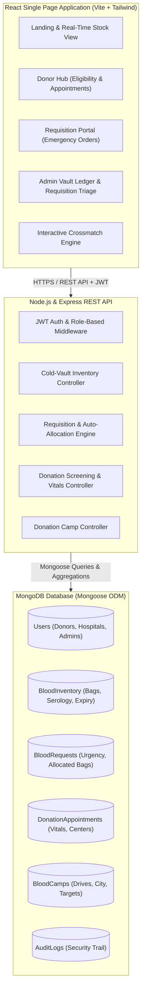
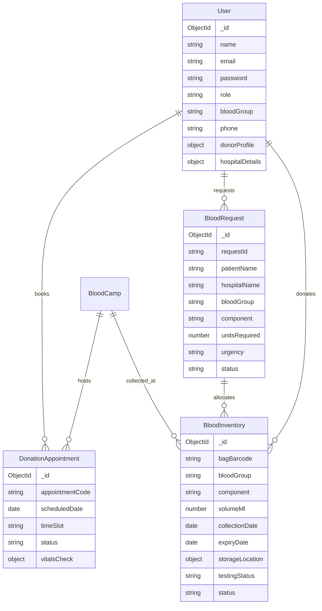

<<<<<<< HEAD
# 🩸 HemoSync — Blood Bank Management System (MERN Stack)

A high-performance, centralized web portal and cold-chain inventory management platform designed for voluntary blood donors, transfusion medicine specialists, hospitals, and blood bank administrators. Built using **MongoDB**, **Express.js**, **React (Vite + Tailwind CSS)**, and **Node.js**.

---

## 🌟 Key Features

1. **Role-Based Access Control (RBAC)**:
   - **Donor**: Profile management, digital donor badge, real-time donation eligibility countdown (56-day clinical interval check), appointment scheduling at centers or mobile camps.
   - **Recipient & Hospital**: Urgent requisition requests (Normal, High, Critical/Code Red), real-time status tracking, barcode allocation visibility.
   - **Blood Bank Admin & Phlebotomy Staff**: Live cold-vault inventory monitoring, viral serology screening (HIV, Hepatitis B/C, Syphilis, Malaria), quarantine release, automated crossmatch compatibility allocation, courier dispatch verification.

2. **Smart Clinical Blood Matching Engine**:
   - ABO and Rh (D) factor precision cross-matching.
   - Component-specific rules: Packed Red Blood Cells (PRBC), Fresh Frozen Plasma (FFP), Whole Blood, and Platelets.
   - Interactive visual simulation tool for clinical teams and donors.

3. **Cold-Chain & Shelf-Life Management**:
   - Automatic expiration tracking based on component shelf-life (Whole Blood ~35 days, PRBC ~42 days, Platelets ~5 days, FFP ~365 days).
   - Real-time stock status: `quarantine` ➔ `available` ➔ `reserved` ➔ `dispatched` / `expired`.

4. **Mobile Blood Donation Camps & Community Outreach**:
   - Schedule and publish city-wide donation drives.
   - Track registered donors vs. target collection quotas.

---

## 📐 System Architecture & Workflow



---

## 🗄️ Database Schemas & Data Model



---

## 🚀 Quick Setup & Installation

### Prerequisites
- **Node.js**: v18.0.0 or higher
- **MongoDB**: Local MongoDB instance or MongoDB Atlas connection string

### 1. Install Dependencies
From the project root:
```bash
# Install root, backend, and frontend packages
npm run install-all
```
*(Or navigate to `server/` and `client/` separately and run `npm install`)*

### 2. Configure Environment Variables
Inside `server/.env`:
```env
PORT=5000
NODE_ENV=development
MONGO_URI=mongodb://127.0.0.1:27017/hemosync_db
JWT_SECRET=super_secret_blood_bank_jwt_key_2026_replace_in_prod
CLIENT_URL=http://localhost:5173
```

### 3. Seed Demo Data
To populate sample donors, hospitals, pre-tested inventory units, donation camps, and requisitions:
```bash
cd server
npm run seed
```

### 4. Run Application
Run backend and frontend simultaneously:
```bash
npm run dev
```
- **Frontend URL**: `http://localhost:5173`
- **Backend API**: `http://localhost:5000/api`

---

## 👥 Demo Logins (Password for all: `password123`)

| Role | Email | Capabilities |
| :--- | :--- | :--- |
| **Admin** | `admin@hemosync.org` | Full access to Vault Ledger, Serology testing, Requisition approvals, Camps |
| **Hospital** | `hospital@stjude.org` | Requisition emergency units, track patient delivery |
| **Donor (O-)** | `marcus.vance@example.com` | View donor card, donation history, book appointments |
| **Recipient** | `david.miller@example.com` | Place individual blood requests |

---

## 🔌 API Endpoints Summary

### Authentication (`/api/auth`)
- `POST /api/auth/register` - Create new user (donor, recipient, hospital)
- `POST /api/auth/login` - Authenticate user & return JWT
- `GET /api/auth/me` - Get logged-in user profile
- `PUT /api/auth/profile` - Update profile / donor vitals

### Cold Vault Inventory (`/api/inventory`)
- `GET /api/inventory/summary` - Aggregate stock by blood group and component
- `GET /api/inventory` - List individual units (filters: group, status, barcode search)
- `POST /api/inventory` - Stock in newly collected unit into quarantine
- `PUT /api/inventory/:id/testing` - Record HIV, HBV, HCV, Syphilis serology results
- `POST /api/inventory/purge-expired` - Auto-detect and flag units past expiry

### Requisitions & Dispatch (`/api/requests`)
- `POST /api/requests` - Raise requisition order (Normal, High, Critical)
- `GET /api/requests/my` - Recipient's request status
- `GET /api/requests` - Admin view of all incoming requisitions
- `PUT /api/requests/:id/review` - Approve/Reject (with automatic crossmatch allocation)
- `POST /api/requests/:id/dispatch` - Confirm physical courier dispatch

### Donations & Screening (`/api/donations`)
- `POST /api/donations/book` - Schedule appointment (enforces 56-day recovery interval)
- `GET /api/donations/my` - Donor appointment history
- `POST /api/donations/:id/process` - Record clinical vitals (Hb, weight, BP) and generate blood bag

### Camps & Analytics (`/api/camps`, `/api/analytics`)
- `GET /api/camps` - List mobile donation drives
- `POST /api/camps` - Publish new camp
- `GET /api/analytics/dashboard` - High-level metrics & critical shortages
- `POST /api/analytics/check-compatibility` - Crossmatch verification logic
=======
# Bloodbank
Blood
>>>>>>> e13c9b9a6546a754f7b7bca86161b033dc94534d
